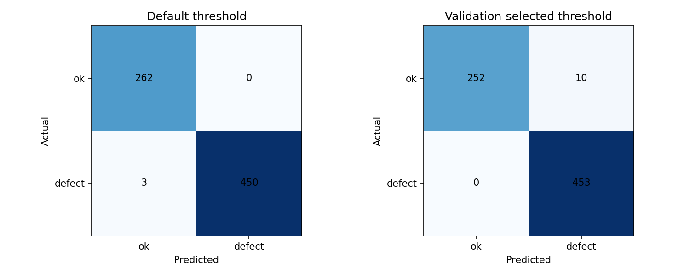
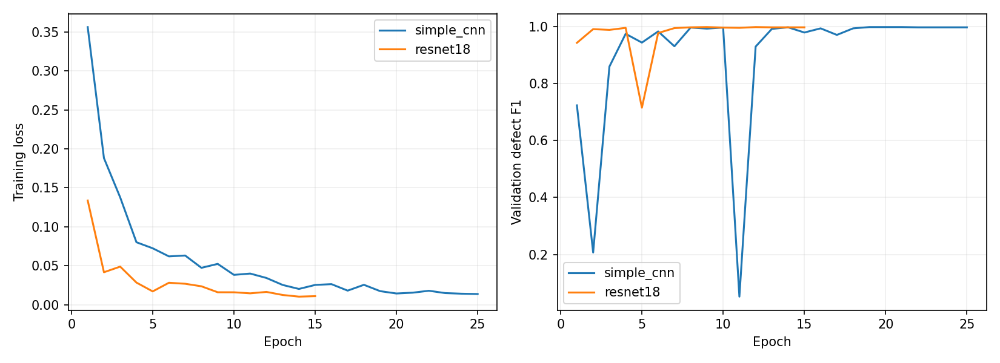
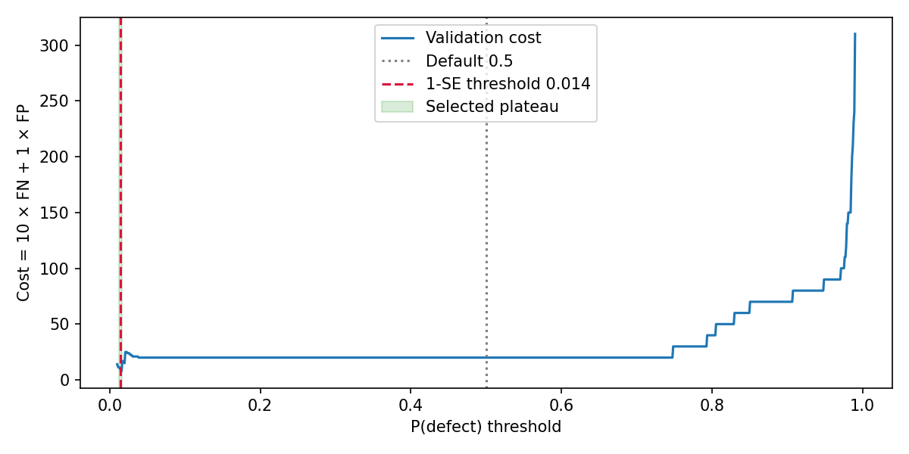
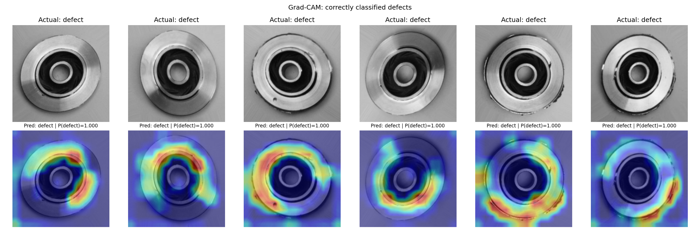
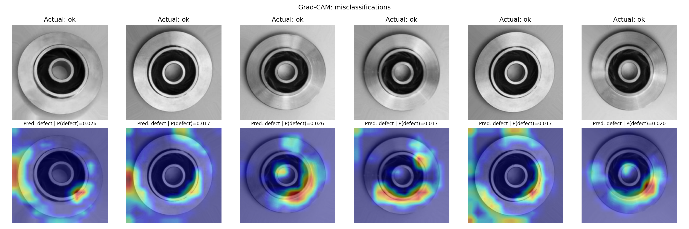

# Casting Defect Classification Using Deep Learning

Binary visual inspection of castings as **acceptable (`ok`)** or **defective (`defect`)**, using a custom CNN, ImageNet-pretrained ResNet18, Grad-CAM, and validation-based decision-threshold selection.

This repository contains the completed Kaggle experiment's original checkpoints, predictions, training histories, reports, and figures, together with runnable local source code and a standalone Kaggle notebook. Training, evaluation, and inference run without deployment.

**Technology stack:** Python, PyTorch, Torchvision, NumPy, Matplotlib, Pillow, and PyYAML.

## Verified outcome

The evaluated model is **SimpleCNN**, trained from scratch. SimpleCNN and ResNet18 tied on their best validation defect F1. The workflow chose SimpleCNN because it appears first in the architecture list; it does not demonstrate statistically significant superiority over ResNet18.

| Test metric — 715 images | Default threshold **0.5** | Validation-selected threshold **0.014** |
|---|---:|---:|
| Accuracy | **99.58%** | **98.60%** |
| Defect precision | 100.00% | 97.84% |
| Defect recall | 99.34% | **100.00%** |
| Defect F1-score | **0.9967** | 0.9891 |
| ROC-AUC | 1.0000 | 1.0000 |
| Missed defects | 3 | **0** |
| Acceptable parts incorrectly flagged | **0** | 10 |

**99.58% accuracy and 100% recall belong to different thresholds.** They must not be reported as a single operating result. ResNet18 test metrics were not exported in this run.



## Dataset and partitioning

Dataset: [Casting Product Image Data for Quality Inspection](https://www.kaggle.com/datasets/ravirajsinh45/real-life-industrial-dataset-of-casting-product). Download the dataset separately; the uploaded project and output archive did not contain the original image folders.

The dataset's supplied `test/` directory is retained. A stratified validation partition is carved from `train/`, using fraction **0.15** and seed **42**.

| Partition | Acceptable | Defective | Total |
|---|---:|---:|---:|
| Training | 2,444 | 3,194 | **5,638** |
| Validation | 431 | 564 | **995** |
| Test | 262 | 453 | **715** |
| Total | 3,137 | 4,211 | **7,348** |

Class convention: **0 = acceptable, 1 = defective**. Torchvision's alphabetical folder labels are explicitly remapped so defect is the positive class. Split membership and ordering are recorded in `split_manifest.csv`.

See [data/README.md](data/README.md) for the required folder structure. The 7,348 distinct paths can be verified from the supplied manifest; duplicate image content cannot be checked without the source images.

## Models and training

| Model | Parameters | Best epoch | Epochs completed | Best validation F1 | Validation ROC-AUC |
|---|---:|---:|---:|---:|---:|
| SimpleCNN | 389,890 | **19** | 25 | **0.998224** | 0.999947 |
| ResNet18 | 11,177,538 | **9** | 15 | **0.998224** | 0.999835 |

SimpleCNN contains four convolution/BatchNorm/ReLU/max-pooling blocks, adaptive average pooling, dropout, and a two-class head. ResNet18 starts from ImageNet weights, replaces its classifier, and fine-tunes the full network. EfficientNet-B0 is also supported in the source, but no trained EfficientNet results are claimed.

- Input: grayscale images converted to three channels and resized to **224 × 224**.
- Training augmentation: horizontal and vertical flips, rotation up to 15 degrees, and translations up to 5%.
- Normalization: ImageNet mean and standard deviation.
- Loss: class-weighted cross-entropy; weights are calculated from training labels only.
- Optimizer: **AdamW**, learning rate **0.001**, weight decay **0.0001**.
- Scheduler: cosine annealing over the configured **25 epochs**.
- Dropout: **0.2**; batch size: **32**; seed: **42**.
- Checkpoint selection: validation defect F1 at threshold **0.5**.
- Early stopping: **6 epochs** without a strict improvement.

The original `config.yaml` uses ResNet18 as its base architecture. Each model checkpoint stores its own actual architecture; `selected_model.pt` correctly stores `simple_cnn`.



## Decision threshold

The operating threshold is selected on **validation predictions before test evaluation**. The code sweeps `0.001` through `0.999`, bootstraps validation **200 times**, and chooses the midpoint of the widest interval whose estimated cost lies within one bootstrap standard error of the minimum.

The completed run selected **0.014**, from the interval **[0.012, 0.016]**. This is a one-standard-error-style selection heuristic, not a guarantee of statistical equivalence or stability. The accepted interval is narrow.

The cost assumption is **10 × missed defects + 1 × false alarms**. Under that assumption, test cost decreases from **30 to 10** when moving from threshold 0.5 to 0.014. These are assumed error-cost units, not observed financial savings.



## Explainability

Grad-CAM uses a forward hook and a tensor-gradient hook on the last convolutional block. It explains the **defect logit** and overlays its heatmap on the normalized-back-to-display image. Printed classifications use the same operating threshold as evaluation.





The error figure shows six of the ten false alarms. Heatmaps highlight casting-ring regions and sometimes background areas. They support inspection of model behavior; they are not verified defect masks, segmentation outputs, or causal explanations.

## Quick start: local CPU

Use **Python 3.12**, the tested local environment. Run commands from the extracted repository folder:

```bash
python -m venv .venv
```

Activate the environment:

```bash
# Windows PowerShell
.venv\Scripts\Activate.ps1

# macOS / Linux
source .venv/bin/activate
```

Install CPU dependencies and verify the provided results:

```bash
python -m pip install -r requirements-cpu.txt
python -m casting_src.verify --check-checkpoints
```

`requirements.txt` specifies the tested package versions. `requirements-cpu.txt` selects CPU Torch/Torchvision wheels. In Kaggle, use its existing compatible GPU packages and the notebook; do not replace them with CPU wheels.

### Predict one image

After downloading the dataset, this example path refers to the image used in the original demonstration:

```bash
python -m casting_src.predict --image data/casting_data/test/def_front/cast_def_0_1059.jpeg --overlay predictions/gradcam.png
```

The default checkpoint is the supplied `artifacts/kaggle_run/selected_model.pt`. Its stored threshold is **0.014**. The output JSON contains the class, raw softmax defect score, threshold, and architecture. An overlay is saved when `--overlay` is supplied.

To use the standard 0.5 operating point:

```bash
python -m casting_src.predict --image data/casting_data/test/def_front/cast_def_0_1059.jpeg --threshold 0.5 --output predictions/default_threshold.json
```

Replace `--image` with any image path. A raw architecture checkpoint, such as `best_resnet18.pt`, defaults to threshold **0.5** unless overridden; the CNN's tuned threshold is not silently applied to ResNet18.

### Train the experiment

Download the image dataset and arrange it as described in [data/README.md](data/README.md). Then run:

```bash
python -m casting_src.train --data-root data/casting_data
```

The default configuration trains SimpleCNN followed by pretrained ResNet18, selects using validation F1, tunes the threshold on validation, evaluates only the selected model, and saves checkpoints, CSV/NPZ predictions, histories, metadata, and plots. ImageNet pretraining requires Internet or cached weights. CPU training works; GPU training is faster.

Useful overrides:

```bash
python -m casting_src.train --data-root data/casting_data --output artifacts/runs/my_run --device cuda
python -m casting_src.train --data-root data/casting_data --architectures simple_cnn --workers 0
```

If pretrained weights are unavailable, `--no-pretrained` explicitly trains backbones from scratch. Such a run should not be described as pretrained ResNet18.

New runs are saved separately under `artifacts/runs/` by default. Nonempty output folders and the original Kaggle artifact directory are protected from overwrite.

### Evaluate a provided checkpoint

```bash
python -m casting_src.evaluate --checkpoint artifacts/kaggle_run/selected_model.pt --data-root data/casting_data --output artifacts/runs/evaluation_check
```

This rebuilds the validation split, recomputes its operating threshold, and evaluates the specified checkpoint. It does not compare or select architectures; its report identifies selection as `provided_checkpoint`. Reusing an already inspected test set does not provide a new independent holdout.

## Run in Kaggle

Import [notebooks/Casting_Defect_Kaggle.ipynb](notebooks/Casting_Defect_Kaggle.ipynb). Attach the linked image dataset, enable a GPU accelerator, and enable Internet for ImageNet weights. Run cells in order.

The notebook contains its source modules and automatically detects the dataset directory. It writes results to `/kaggle/working/casting_outputs` and creates `/kaggle/working/casting_outputs.zip`. No external application is required.

## Reproducibility and verification

Original run metadata records **Python 3.13.15**, **PyTorch 2.11.0+cu128**, **Torchvision 0.26.0+cu128**, **NumPy 2.1.3**, and a **Tesla T4 GPU**. This repository's requirements describe the tested local CPU runtime, not an exact copy of every Kaggle package.

The retained original numerical/model artifacts are preserved byte for byte, with a SHA-256 manifest added. Source checkpoint loaders rebuild the architecture with `pretrained=False` and restore saved weights, so prediction does not need another ImageNet download.

```bash
python -m casting_src.verify --check-checkpoints
python -m pip install -r requirements-dev.txt
python -m pytest -q
```

Verification checks prediction/label alignment, dataset counts, seeded split reconstruction, validation model selection, best epochs, both test metrics, bootstrap threshold reproduction, artifact hashes, checkpoint structures, and selected-model weight identity.

Repository preparation passed **11 regression tests** and a complete synthetic-data workflow check. See [docs/VALIDATION.md](docs/VALIDATION.md) for the exact checks and their limits. `.gitattributes` preserves original artifact bytes across Git checkouts, including on Windows.

The source images were not supplied with the output archive. Consequently, original full-dataset model inference has not been independently rerun during repository preparation. Numerical reports can be verified from saved predictions; model loading and inference plumbing can be checked separately. GPU/CPU and library differences may affect a fresh training run.

## Repository contents

| Path | Purpose |
|---|---|
| `casting_src/` | Dataset transforms, architectures, training, evaluation, prediction, Grad-CAM, metrics, and verification |
| `configs/default.yaml` | Settings matching the completed experiment |
| `notebooks/Casting_Defect_Kaggle.ipynb` | Standalone Kaggle notebook |
| `artifacts/kaggle_run/` | Original checkpoints, reports, arrays, CSV files, images, configuration, and source snapshot |
| `data/README.md` | Dataset download and folder-layout instructions |
| `docs/` | Methodology, result interpretation, validation scope, and GitHub upload instructions |
| `tests/` | Artifact, metric, model, class-remapping, threshold, and Grad-CAM checks |
| `.github/workflows/checks.yml` | CPU verification/test workflow for GitHub |

## Limitations

- Results describe one dataset split and one seed; no external factory or camera validation is included.
- The test set contains **453 defects out of 715 images**; this prevalence does not establish a real factory defect rate.
- Probabilities are raw softmax outputs, without probability calibration.
- The threshold's accepted interval is narrow and may not transfer to other conditions.
- Grad-CAM does not provide verified defect localization.
- No defect-type classification, deployment, automated monitoring, or production financial benefit is claimed.


